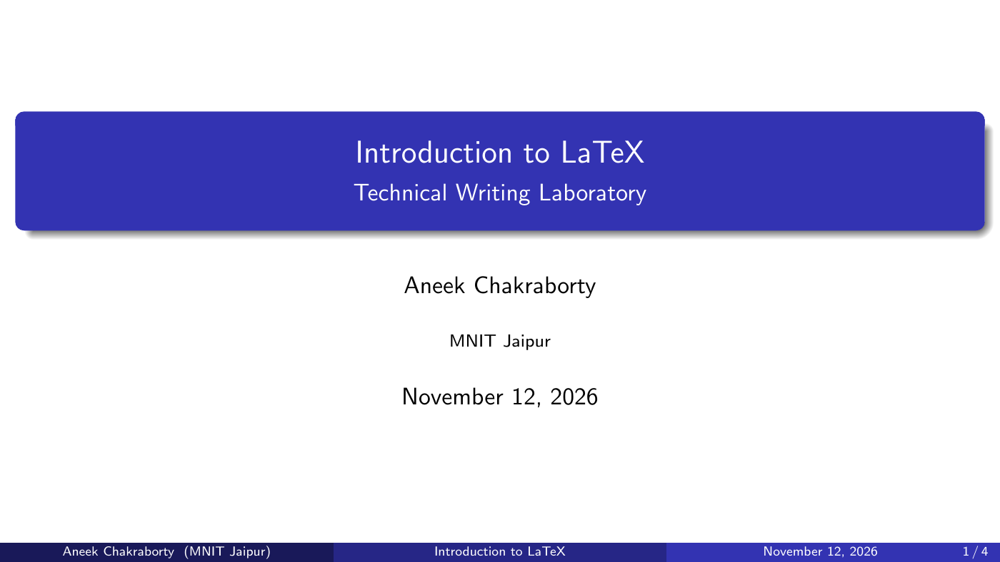

# 🎞️ Beamer — Academic Presentations

### 🖼️ Output Preview



## 🧪 Open the Working Example

- [Editable presentation source](examples/presentation.tex)
- [Compiled four-slide PDF](output/presentation.pdf)

Compare each `frame` in the source with the corresponding PDF slide.

## Technical Writing Laboratory | MNIT Jaipur

> **Organise ideas. Present clearly.**

## 📌 Introduction

Beamer is a LaTeX document class for creating presentations.
It supports structured slides, mathematical expressions, themes,
blocks, columns, and overlays.

The source is saved as a `.tex` file and compiled into a PDF presentation.

## 🎯 Learning Objectives

- Create a presentation using the `beamer` document class.
- Organise content into frames.
- Add a title slide and presentation metadata.
- Display lists, equations, and highlighted blocks.
- Use themes and arrange content in columns.
- Reveal content progressively using overlays.

## 🏗️ Basic Structure

```latex
\documentclass{beamer}
\usetheme{Madrid}

\title{Introduction to LaTeX}
\author{Student Name}
\institute{MNIT Jaipur}
\date{\today}

\begin{document}

\begin{frame}
    \titlepage
\end{frame}

\begin{frame}{Introduction}
    LaTeX helps prepare structured technical documents.
\end{frame}

\end{document}
```

| Command | Purpose |
| :--- | :--- |
| `\documentclass{beamer}` | Creates a Beamer presentation |
| `\usetheme{Madrid}` | Selects the presentation theme |
| `\title{...}` | Sets the presentation title |
| `\author{...}` | Sets the author |
| `\institute{...}` | Sets the institution |
| `\date{\today}` | Uses the compilation date |
| `\titlepage` | Displays the title information |
| `\begin{frame}{Title}` | Starts a frame with a title |

## 🖥️ Frames and Slides

A **frame** is a logical unit of presentation content.

A simple frame produces one PDF slide. A frame with overlays
can produce multiple PDF slides that reveal content progressively.

```latex
\begin{frame}{Advantages of LaTeX}
    \begin{itemize}
        \item Consistent formatting
        \item Mathematical typesetting
        \item Automatic cross-references
    \end{itemize}
\end{frame}
```

## 🎨 Themes

Themes control the visual appearance of a presentation.

```latex
\usetheme{Madrid}
```

Other examples include `Berlin`, `CambridgeUS`, and `Boadilla`.
Choose one theme for the presentation.

A colour theme can be selected separately:

```latex
\usecolortheme{dolphin}
```

For a widescreen presentation:

```latex
\documentclass[aspectratio=169]{beamer}
```

## 📋 Lists and Progressive Reveal

### Numbered List

```latex
\begin{frame}{Document Preparation}
    \begin{enumerate}
        \item Write the source.
        \item Compile the document.
        \item Inspect the PDF.
    \end{enumerate}
\end{frame}
```

### Using Pause

```latex
\begin{frame}{Workflow}
    Write the source.
    \pause

    Compile the document.
    \pause

    Review the output.
\end{frame}
```

### Overlay Specifications

```latex
\begin{frame}{Key Features}
    \begin{itemize}
        \item<1-> Structured content
        \item<2-> Consistent formatting
        \item<3-> Mathematical expressions
    \end{itemize}
\end{frame}
```

`<2->` means the item appears from overlay 2 onward.

## 💡 Blocks

Blocks visually group important information.

```latex
\begin{frame}{Important Concepts}

    \begin{block}{Definition}
        Beamer is a LaTeX class for presentations.
    \end{block}

    \begin{alertblock}{Remember}
        Keep slide content concise and readable.
    \end{alertblock}

    \begin{exampleblock}{Example}
        Use Beamer for a technical seminar.
    \end{exampleblock}

\end{frame}
```

| Environment | Purpose |
| :--- | :--- |
| `block` | General information |
| `alertblock` | Emphasised information |
| `exampleblock` | Examples |

## ➗ Mathematics

Beamer supports LaTeX mathematical notation.

```latex
\begin{frame}{Mathematical Example}
    The sum of the first \(n\) positive integers is:
    \[
        \sum_{i=1}^{n} i = \frac{n(n+1)}{2}
    \]
\end{frame}
```

## ↔️ Columns

Use columns to place content side by side.

```latex
\begin{frame}{LaTeX and Beamer}
    \begin{columns}[T]

        \begin{column}{0.48\textwidth}
            \textbf{LaTeX Documents}
            \begin{itemize}
                \item Reports
                \item Articles
                \item Books
            \end{itemize}
        \end{column}

        \begin{column}{0.48\textwidth}
            \textbf{Beamer Presentations}
            \begin{itemize}
                \item Seminars
                \item Project presentations
                \item Lectures
            \end{itemize}
        \end{column}

    \end{columns}
\end{frame}
```

## 🖼️ Images

```latex
\begin{frame}{Illustration}
    \centering
    \includegraphics[
        width=0.7\textwidth,
        height=0.65\textheight,
        keepaspectratio
    ]{example-image.png}
\end{frame}
```

Replace `example-image.png` with an actual image in the project.
Beamer loads the `graphicx` package automatically.

## 💻 Displaying Code

Frames containing a `verbatim` environment require the
`fragile` option.

```latex
\begin{frame}[fragile]{A Simple LaTeX Command}
\begin{verbatim}
\textbf{Bold text}
\end{verbatim}
\end{frame}
```

## 🧪 Complete Four-Slide Example

The report-and-presentation assignment asks for a short
3–4-slide presentation supporting the LaTeX report.

This example contains a title slide, two content slides,
and a concluding slide.

Save it as `presentation.tex`.
Replace `Student Name` with your name.

```latex
\documentclass[aspectratio=169]{beamer}
\usetheme{Madrid}
\setbeamertemplate{navigation symbols}{}

\title{Introduction to LaTeX}
\subtitle{Technical Writing Laboratory}
\author{Student Name}
\institute{MNIT Jaipur}
\date{\today}

\begin{document}

% Slide 1: Title
\begin{frame}
    \titlepage
\end{frame}

% Slide 2: Introduction
\begin{frame}{What Is LaTeX?}
    \begin{itemize}
        \item A document preparation system built on TeX.
        \item Uses commands to express document structure.
        \item Useful for reports and research papers.
        \item Supports high-quality mathematical typesetting.
    \end{itemize}
\end{frame}

% Slide 3: Features
\begin{frame}{Features Demonstrated in the Report}
    \begin{itemize}
        \item Title page and abstract.
        \item Chapters, sections, and subsections.
        \item Custom margins and heading colours.
        \item Headers containing document information.
    \end{itemize}

    \begin{block}{Main Benefit}
        Structured source helps maintain consistent formatting.
    \end{block}
\end{frame}

% Slide 4: Conclusion
\begin{frame}{Conclusion}
    \begin{itemize}
        \item LaTeX supports structured technical writing.
        \item Beamer extends this workflow to presentations.
        \item Concise slides help communicate ideas clearly.
    \end{itemize}

    \vfill
    \centering
    \textbf{Thank you!}
\end{frame}

\end{document}
```

## ▶️ Compilation

Compile locally:

```bash
pdflatex presentation.tex
```

Run again if references or navigation information need updating.

Alternatively, create a project in Overleaf, paste the source,
and select **Recompile**.

The resulting file is `presentation.pdf`.

## ✅ Presentation Checklist

- Use a clear title for each content frame.
- Keep text brief and readable.
- Use consistent colours and formatting.
- Avoid overcrowding frames.
- Check equations and image dimensions.
- Inspect the compiled PDF before presenting.

## 📚 References

- Technical Writing course materials, MNIT Jaipur.
- Assignment 5: Report & Presentation.
- Beamer package and documentation: https://ctan.org/pkg/beamer

---

[⬅️ Back to Main Repository](../README.md)
