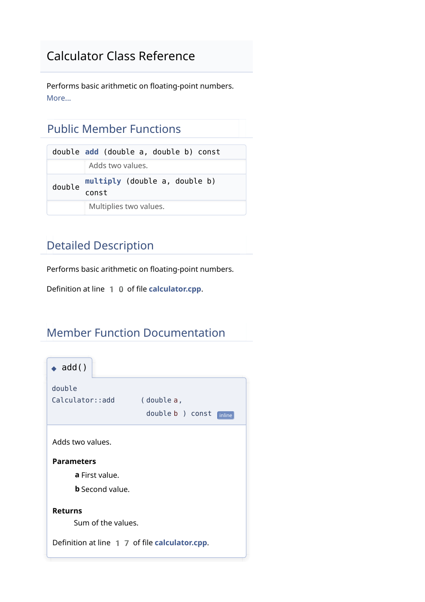

# ⚙️ Doxygen — Source-Code Documentation

### 🖼️ Generated Documentation Preview



This is a print-rendered view of the generated HTML, not a browser-session screenshot.

## 🧪 Runnable Example and Generated Output

- [Documented C++ source](examples/calculator.cpp)
- [Doxyfile](Doxyfile)
- [Captured sample run](example-run.txt)
- [Download generated HTML and LaTeX sources](generated-documentation.zip)

Extract `generated-documentation.zip` and open `generated-docs/html/index.html` locally; GitHub displays HTML source rather than serving the documentation interface. The HTML was generated with Doxygen 1.15.0. A [printable class reference](output/calculator-reference.pdf) is exported from the generated HTML. The ZIP also contains LaTeX sources. This is a standalone demonstration, not a replacement for the supplied multi-file lab assignment.

To regenerate, run `doxygen Doxyfile` inside the Doxygen directory.

## Technical Writing Laboratory | MNIT Jaipur

> **Document the purpose. Explain the interface.**

## 📌 Introduction

Doxygen is a documentation generator that extracts information
from source code and specially formatted comments.

It helps create reference documentation for functions, classes,
files, and other program elements.

It can generate HTML for browsing and LaTeX output that can
be compiled into a PDF manual.

## 🎯 Learning Objectives

- Write structured documentation comments.
- Document functions, parameters, return values, and classes.
- Configure documentation generation using a Doxyfile.
- Generate and inspect HTML documentation.
- Understand the workflow for producing a PDF manual.

## 🔄 Basic Workflow

1. Write the source code.
2. Add Doxygen documentation comments.
3. Create and edit the configuration file.
4. Run Doxygen.
5. Open the generated documentation and check its accuracy.

## ✍️ Documentation Comments

Doxygen recognises special comment styles such as:

```cpp
/**
 * @brief A short description.
 */
```

Another supported style is:

```cpp
/// A short documentation comment.
```

Commands may use `@` or `\`, for example:
`@brief` and `\brief`.

## 🏷️ Important Tags

| Tag | Purpose |
| :--- | :--- |
| `@file` | Documents a source or header file |
| `@mainpage` | Defines the main documentation page |
| `@brief` | Provides a short summary |
| `@details` | Introduces a detailed description |
| `@param` | Describes a function parameter |
| `@return` | Describes the return value |
| `@class` | Documents a class |
| `@enum` | Documents an enumeration |
| `@author` | Records author information |
| `@version` | Records version information |
| `@note` | Adds an explanatory note |
| `@warning` | Highlights a warning |
| `@todo` | Records planned work |
| `@see` | Refers to related documentation |

Use `@details`, not `@detail`.

`@mainpage` provides the project overview.
`@file` documents an individual file.

## ➕ Documenting a Function

```cpp
/**
 * @brief Adds two integers.
 *
 * @param a First integer.
 * @param b Second integer.
 * @return Sum of a and b.
 */
int add(int a, int b) {
    return a + b;
}
```

Documentation should explain the function's purpose and
expected behaviour, including relevant input restrictions.

Parameter names in `@param` must match the function declaration.

## 🧱 Documenting a Class

```cpp
/**
 * @brief Performs basic mathematical operations.
 */
class Calculator {
public:
    /**
     * @brief Multiplies two numbers.
     * @param a First number.
     * @param b Second number.
     * @return Product of a and b.
     */
    double multiply(double a, double b) const {
        return a * b;
    }
};
```

A comment immediately before a class declaration can document
the class without an explicit `@class` command.

## 🗂️ Documenting an Enumeration

```cpp
/**
 * @brief Available logging severity levels.
 */
enum class LogLevel {
    Info,     ///< General information.
    Warning,  ///< A potential problem.
    Error     ///< An error condition.
};
```

`///<` documents the member immediately before the comment.

## 🛠️ Configuration File

A **Doxyfile** controls which files Doxygen reads and
which documentation outputs it generates.

Create a template configuration:

```bash
doxygen -g Doxyfile
```

### Important Settings

| Setting | Purpose |
| :--- | :--- |
| `PROJECT_NAME` | Documentation project title |
| `OUTPUT_DIRECTORY` | Base directory for generated output |
| `INPUT` | Source files or directories to process |
| `FILE_PATTERNS` | File patterns to include |
| `RECURSIVE` | Whether to search subdirectories |
| `EXTRACT_ALL` | Whether to include undocumented entities |
| `GENERATE_HTML` | Enables HTML output |
| `GENERATE_LATEX` | Enables LaTeX output |
| `HAVE_DOT` | Enables integration with Graphviz dot |

Setting `EXTRACT_ALL = YES` includes undocumented entities;
it does not write explanations for them.

Graphviz must be installed and available to use `HAVE_DOT = YES`.

## 🧪 Complete Practical Example

This is a standalone practice example.
The supplied laboratory assignment uses a separate multi-file project.

Create these two input files in the same folder:

| File | Purpose |
| :--- | :--- |
| `calculator.cpp` | Documented C++ source |
| `Doxyfile` | Documentation configuration |

### 1. Source File: calculator.cpp

```cpp
/**
 * @file calculator.cpp
 * @brief A simple documented addition program.
 */

/**
 * @mainpage Calculator Documentation
 *
 * This example demonstrates file documentation,
 * function documentation, parameters, and return values.
 *
 * The program accepts two integers and displays their sum.
 */

#include <iostream>

/**
 * @brief Adds two integers.
 *
 * @param a First integer.
 * @param b Second integer.
 * @return The sum of the two integers.
 *
 * @pre The mathematical sum must fit in the int type.
 */
int add(int a, int b) {
    return a + b;
}

/**
 * @brief Reads input and displays the addition result.
 * @return 0 on success, or 1 if input cannot be read.
 */
int main() {
    int a, b;

    std::cout << "Enter first integer: ";
    if (!(std::cin >> a)) {
        std::cerr << "Invalid input.\n";
        return 1;
    }

    std::cout << "Enter second integer: ";
    if (!(std::cin >> b)) {
        std::cerr << "Invalid input.\n";
        return 1;
    }

    std::cout << "Sum: " << add(a, b) << '\n';
    return 0;
}
```

### 2. Configuration File: Doxyfile

```text
PROJECT_NAME           = "Calculator Documentation"
OUTPUT_DIRECTORY       = docs
INPUT                  = calculator.cpp
FILE_PATTERNS          = *.cpp *.h
RECURSIVE              = NO
EXTRACT_ALL            = NO
WARN_IF_UNDOCUMENTED   = YES
GENERATE_HTML          = YES
GENERATE_LATEX         = YES
HAVE_DOT               = NO
```

### 3. Generate Documentation

Run from the folder containing both files:

```bash
doxygen --version
doxygen Doxyfile
```

Open the generated HTML file:

```text
docs/html/index.html
```

Doxygen reads the source code; compiling the C++ program is
not required to generate its documentation.

### 4. Compile and Run the Program Separately

Using a terminal with g++:

```bash
g++ calculator.cpp -o calculator
```

Run on Linux:

```bash
./calculator
```

Run on Windows PowerShell:

```powershell
.\calculator.exe
```

Example interaction:

```text
Enter first integer: 12
Enter second integer: 8
Sum: 20
```

### 5. Generate the PDF Manual

Doxygen first produces LaTeX files.
A LaTeX installation is needed to compile them into a PDF.

On a system with LaTeX and make installed:

```bash
cd docs/latex
make
```

The resulting manual is normally named:

```text
refman.pdf
```

On Windows, the generated LaTeX directory may also contain
a `make.bat` build script.

## 📚 Connection to the Laboratory Assignment

The uploaded Doxygen assignment describes these project files:

| File | Role |
| :--- | :--- |
| `Logger.h` | Logging class and related declarations |
| `CalculationEngine.h` | Mathematical operations using the logger |
| `main.cpp` | Application entry point |
| `Doxyfile` | Documentation generation settings |

The assignment requires documentation of classes, constructors,
enumerations, parameters, and return values.

Its requested submission includes:
- The three documented source files.
- The final Doxyfile.
- A screenshot of generated HTML documentation.
- The generated PDF manual.

The standalone calculator example above demonstrates the workflow;
it does not replace the supplied assignment project.

## 🔍 Checking the Generated Documentation

- Confirm the main page describes the project.
- Check that functions and classes appear.
- Verify parameter descriptions match the source.
- Check return-value descriptions.
- Read and resolve relevant Doxygen warnings.
- Open the HTML and PDF outputs to inspect them.

## 💡 Key Takeaways

- Documentation comments should explain purpose and behaviour.
- A Doxyfile makes documentation generation repeatable.
- HTML is useful for browsing linked references.
- LaTeX output can be compiled into a printable PDF manual.
- Documentation should be updated when the code changes.

## 📚 References

- Technical Writing slides: Doxygen & Google Docs, MNIT Jaipur.
- Doxygen laboratory assignment.
- Official website: https://www.doxygen.nl/
- Documentation manual: https://www.doxygen.nl/manual/

---

[⬅️ Back to Main Repository](../README.md)
