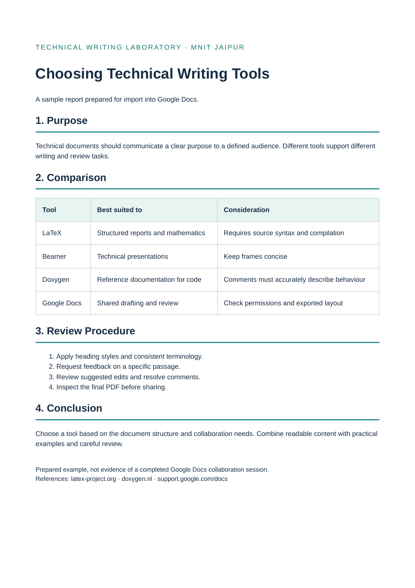

# Sample report

Open `sample-report.html` locally or import it into Google Docs. The PDF is a HTML-rendered export of this prepared sample, not a Google Docs export.

To create your own evidence: import the report, apply heading styles, add a comment, suggest an edit, and inspect version history. Capture the actual screens from your account. Sharing with a collaborator is optional unless your assignment requires it.

[Download PDF](sample-report.pdf) · [Open editable HTML](sample-report.html)

