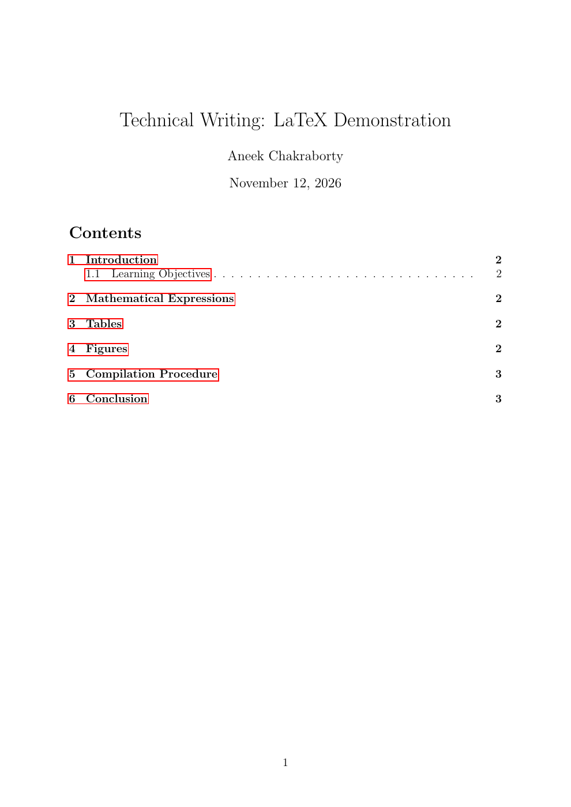
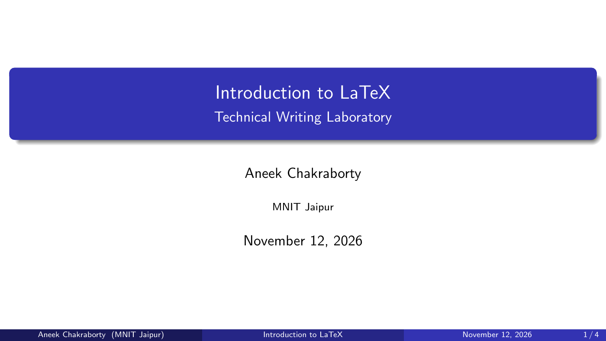

# 📚 Technical Writing — Learning Portfolio

### Technical Writing Laboratory | MNIT Jaipur

> **Write clearly. Document effectively. Collaborate confidently.**

Course notes and practical examples covering document preparation,
presentations, code documentation, collaborative writing, and version control.

## 🗂️ Course Modules

| Topic | Documentation | Practical work |
| :--- | :--- | :--- |
| 📝 LaTeX | [Notes](LaTeX/README.md) | [Source](LaTeX/examples/sample-document.tex) · [PDF](LaTeX/output/sample-document.pdf) |
| 🎞️ Beamer | [Notes](Beamer/README.md) | [Source](Beamer/examples/presentation.tex) · [Slides](Beamer/output/presentation.pdf) |
| ⚙️ Doxygen | [Notes](Doxygen/README.md) | [C++ source](Doxygen/examples/calculator.cpp) · [Generated docs](Doxygen/generated-documentation.zip) · [PDF reference](Doxygen/output/calculator-reference.pdf) |
| 📄 Google Docs | [Notes](Google-Docs/README.md) | [Sample report](Google-Docs/examples/sample-report.pdf) · [Editable version](Google-Docs/examples/sample-report.html) |
| 🌿 Git | [Commands and concepts](Git/README.md) | [Branch and merge output](Git/evidence/README.md) |
| 🌐 GitHub | [Repository workflows](GitHub/README.md) | This repository and its commit history |

## 🖼️ Practical Preview

| LaTeX document | Beamer presentation |
| :--- | :--- |
|  |  |

## ▶️ Using the Examples

- **LaTeX and Beamer:** open the `.tex` source in Overleaf or compile with pdfLaTeX.
- **Doxygen:** extract the documentation ZIP and open `generated-docs/html/index.html`. To regenerate, run `doxygen Doxyfile` inside the Doxygen folder.
- **Google Docs:** import the editable sample report and practise formatting, comments, and suggestions.
- **Git:** use the command notes in a separate practice repository.

Preview images show rendered outputs. The Git reference run was generated in an
isolated environment; the Google Docs report is a prepared import sample.

## 🎯 Learning Objectives

- Prepare structured technical documents and presentations.
- Explain source-code interfaces through documentation comments.
- Review and collaborate on written content.
- Track changes, manage branches, and work with remote repositories.

## 📚 References

Course lecture slides and laboratory assignments are the primary references.
Additional resources: [LaTeX](https://www.latex-project.org/),
[Doxygen](https://www.doxygen.nl/manual/),
[Google Docs](https://support.google.com/docs/),
[Git](https://git-scm.com/doc), and [GitHub](https://docs.github.com/).
