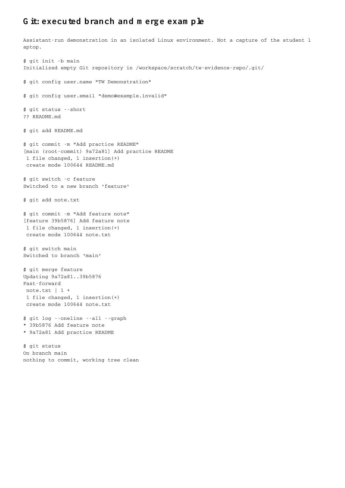

# Git execution evidence

[Read the captured transcript](01-branch-merge.txt) or [open its formatted view](01-branch-merge.html).

These commands were executed by the assistant in an isolated Linux repository. The image is a rendered PDF page of the recorded transcript, not a screenshot of the student's Git Bash window. Commit hashes will differ when you repeat the exercise. This demonstrates working commands but does not certify student proficiency.
